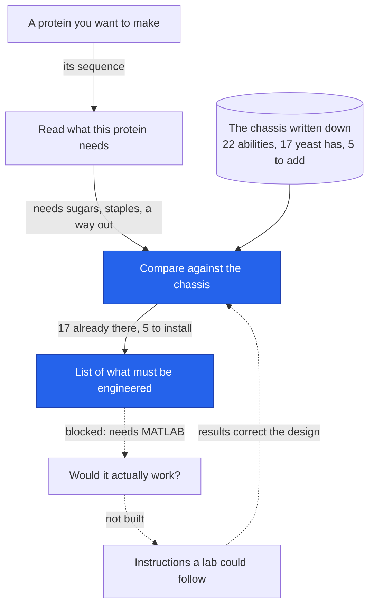
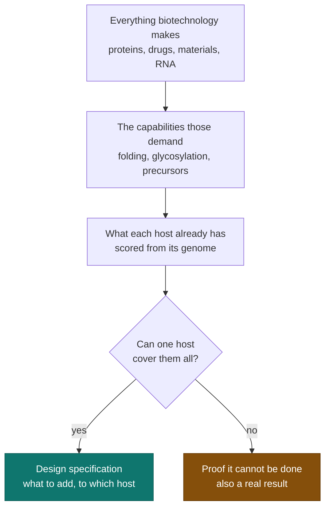
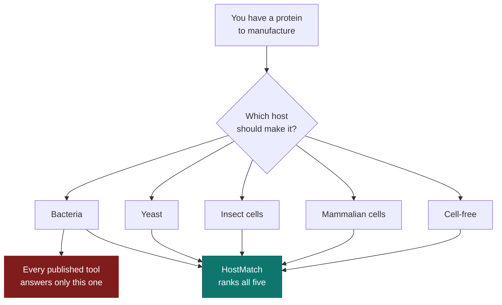
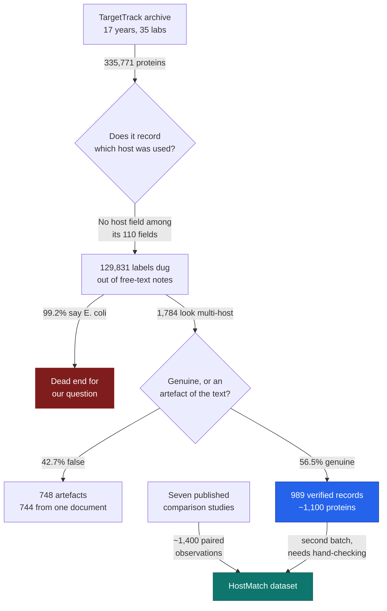

# HostMatch — project story

The durable record. Newest checkpoint at the top. Each entry is written to be
readable without the conversation it came from.

## Checkpoints
1. **2026-10-28 - The goal is set: the virtual chassis** (below)
1. **2026-10-24 - MATLAB was never the obstacle** (below)
1. **2026-10-24 - Physics added, and it overturned a conclusion** (below)
1. **2026-10-24 - The whole project in plain language** (below)
1. **2026-10-24 - The chassis becomes an object, and the first code runs** (below)
1. **2026-10-23 - It is a tool, and its data layer already exists** (below)
1. **2026-10-23 - Idea sharpened: proteins, and a data-driven design layer** (below)
1. **2026-10-21 — A candidate named: the rules choose yeast** (below)
2. **2026-10-20 — Control solved, and a number keeps appearing**
2. **2026-10-20 — The budget question, answered: switchable or nothing**
2. **2026-10-20 — Conflicts found: the minimal-cell route is wrong**
3. **2026-10-20 — The checklist exists: 37 capabilities**
3. **2026-10-20 — The target is a universal chassis**
4. **2026-10-20 — How we got here, and what HostMatch is**
5. **2026-10-17 — The big database does not have what we needed**

---

# 2026-10-28 — The goal is set, and the test that would falsify it is feasible

Records: [`protocol/goal-definition-v1.md`](../protocol/goal-definition-v1.md),
[`reports/03-validation-set-feasibility.md`](../reports/03-validation-set-feasibility.md).

## The goal, decided

Three candidates had been named: a specification a human lab reproduces, a tool
driving an autonomous lab, and the virtual chassis as the deliverable itself.

**They are not alternatives. They are a ladder** — goals 1 and 2 are
applications of goal 3, because the specification a lab or a robot receives is
what the virtual chassis emits.

**Decided: the virtual chassis is the project.** Goal 2 is a design constraint,
by emitting machine-executable output from the start. Goal 1 is eventual
validation, not a dependency.

The deciding argument is accountability: **it is the only one the project owner
can falsify alone**, against the literature, at no cost, within months. The
other two outsource the verdict to a facility nobody here has.

**And the project's own evidence argues against goal 1 specifically.**
Architecturally similar scFvs diverged under identical engineering, and a single
specification handed over once is exactly the form that result threatens.

## The danger, named

A model of an organism nobody builds can be refined indefinitely without being
shown wrong. **That failure is comfortable and it is fatal.** The guard is a
retrospective test: run the tool blind against published yeast expression
campaigns and ask whether it names the modifications those campaigns needed.

## The feasibility check, run before committing

Sample of **40 abstracts**, keyword-selected, scored by reading.

| | Roughly |
|---|---|
| Names a specific protein | almost all |
| Names a specific modification, at gene resolution | almost all |
| Quantitative outcome in the abstract | about 1 in 4 |

**(protein, modification) pairs are extractable at scale.** Outcomes usually
need full text, which raises cost but does not block the test.

## The find that changes how the set should be built

**The literature contains cases where the same modification helped one protein
and not another.** At least four in forty:

- *"Overexpression of binding protein and disruption of the PMR1 gene
  synergistically stimulate secretion of **bovine prochymosin but not plant
  thaumatin**"*
- *"**Protein disulfide isomerase, but not binding protein**, overexpression
  enhances secretion of a **non-disulfide-bonded protein**"*
- *"**Contrasting** secretory processing"* — BPTI versus scFv D1.3, same cell
- the Pichia scFv divergence result already on file

**These are the cases that would actually falsify the chassis**, because they
test discrimination rather than recall. A tool that recommends PDI for
everything scores well on successes and fails completely here. **The set should
be built around them deliberately.**

The second one is a direct hit on a rule currently in the code: **PDI improves
secretion of a protein with no disulfide bonds.** The chassis fires its
disulfide capability on cysteine count, and
[`reports/02-feature-validation.md`](../reports/02-feature-validation.md)
already caught that rule misfiring on seven proteins. The literature says the
relationship is not the one the tool assumes.

## The limitation that shapes what the test can claim

**Papers report what worked. They rarely report what was tried and failed.**

- **Recall is measurable** — the tool says humanised glycans, the paper says
  they humanised the glycans.
- **Precision is mostly not** — the tool says chaperone, the paper is silent,
  and we cannot tell a false positive from something nobody tried.

**The test can show the tool misses things. It cannot cleanly show the tool
over-prescribes.** Any score must say which it is.

## Decisions recorded

| Decision | Against | Why |
|---|---|---|
| The virtual chassis is the deliverable | A wet-lab spec, or an autonomous-lab system | The only one falsifiable by the owner alone, at no cost, within months |
| Emit machine-executable output from the start | Designing the output format later | Cheap now, expensive to retrofit, keeps the autonomous-lab goal reachable |
| Check feasibility before building the set | Building it and finding out | A test that cannot be made to work would have cost weeks |
| Build the set around differential cases | Collecting successes by keyword | Successes test recall; only differential cases test discrimination |
| Report recall and precision separately | A single accuracy number | Publication bias makes precision uninterpretable |

## Not done

- **No validation set exists.** Feasibility only.
- **The 40-abstract sample is not random** — both searches selected for papers
  reporting engineering, so the coverage figures are an **upper bound**.
- **Scoring was by reading, not by script**, so it is not reproducible the way
  the UniProt validation is.
- **No full texts retrieved.** Extractability of outcomes from full text is
  assumed.
- **Older papers dominate the secretion sample**, several from the 1990s, across
  three decades of differing strains and assays.
- **The blind condition needs enforcing.** Predictions must be frozen before the
  papers are read, or the test is worthless.
- No protocol output format has been designed, so the goal-2 design constraint
  is a statement of intent and nothing more.

---

# 2026-10-24 — MATLAB was never the obstacle

Record: [`scripts/pcsec.py`](../scripts/pcsec.py), and the correction appended to
[`protocol/theory-stack-v1.md`](../protocol/theory-stack-v1.md).
Run it with `python -I scripts/pcsec.py`.

**Hours earlier this project recorded MATLAB access as its central obstacle.
That was wrong, and testing the assumption took one afternoon.**

## The assumption

Both pcSecYeast repositories state in their READMEs that they require MATLAB
R2020b, the COBRA Toolbox, the RAVEN Toolbox and the SoPlex solver. This project
read that, repeated it across three documents, and concluded that two of the
three highest-value theory layers were unreachable.

**Nobody had opened the repository to check what was actually in it.**

## The fact

**MATLAB is required to BUILD those models. It is not required to USE them.**

`pcSecYeastSpecies` commits the **built models** as `.mat` files under an **MIT
licence** — `pcSecYeast.mat`, `pcSecPichia.mat`, `pcSecKmarx.mat`, plus
variants. A `.mat` file is a container, not a program. `scipy.io` reads it, and
the linear program inside is solved by **HiGHS, which ships with scipy**.

| | |
|---|---|
| Model | **25,776 metabolites x 37,688 reactions**, 1,156 genes |
| Loaded with | `scipy.io.loadmat` — every standard COBRA field present |
| Solved with | **HiGHS, bundled with scipy. No MATLAB, no SoPlex** |
| Result | **Optimal in 6 seconds**, biomass reaction `r_2111` at 0.1418 |
| Download | **1.6 MB** |

## And the machinery is all there

The reactions our five engineered modules need costs for:

| Probe | Reactions in the model |
|---|---:|
| folding | **6,646** |
| degradation | 3,460 |
| protein | 1,295 |
| Golgi | 908 |
| **glycosylation** | **805** |
| translocation | 361 |
| mannosylation | 133 |
| **disulfide** | **63** |

`chassis-v1.json` records `cost_status: not measured` for every engineered
module, and that gap is why the proteome budget constraint cannot be checked
against a real configuration. **The source of those costs is now open.**

## Two conclusions overturned in one day

| Conclusion | Lifetime | What killed it |
|---|---|---|
| The 40% ceiling is a budget you may spend up to | weeks | growth-law coupling: the optimum is 20%, and 40% is zero yield |
| MATLAB access is the central obstacle | hours | the models ship built, and scipy solves them |

Both were load-bearing. Both were stated confidently. **Neither survived being
checked.**

## Decisions recorded

| Decision | Against | Why |
|---|---|---|
| Consume the built models | Getting a MATLAB licence; porting to Octave; reimplementing in Python | The models are already built, MIT-licensed, and 1.6 MB. None of the alternatives were needed |
| Download rather than commit the models | Vendoring them into this repository | They are third-party; the script fetches them, so there is no redistribution question and no stale copy |
| Record the error prominently | Quietly editing the blocker away | Three documents repeated an unchecked README claim; the correction is more useful than the tidy version |

## Not done

- **This solves the model as shipped.** The authors' published results set media,
  heterologous protein and enzyme constraints through their MATLAB scripts, and
  **that logic has not been reimplemented.** Solving the model is not the same
  as using it the way the paper does.
- **No module cost extracted yet.** The source is open; nothing has been taken
  from it.
- **The objective value is unvalidated.** 0.1418 has not been checked against any
  published number. It is a solve, not a validation.
- **Octave was investigated and is not a route** — the COBRA Toolbox has an open
  issue where Octave's native GLPK interface "is detected as unavailable". It
  did not matter in the end.
- The chassis object and the simulator still show the uncorrected 40% ceiling.

---

# 2026-10-24 — Physics added, and it overturned one of our own conclusions

Records: [`protocol/theory-stack-v1.md`](../protocol/theory-stack-v1.md),
[`scripts/growth_coupling.py`](../scripts/growth_coupling.py).
Run it with `python -I scripts/growth_coupling.py`.

**The instruction: stop building a tool that matches rules and ground it in the
quantitative theory the field has established.** That is the right criticism.

## What the tool was

`chassis_resolve.py` is a **rule matcher**. Does this protein have cysteines,
does it have sequons, yes or no. **It contains no rates, no energies, no
concentrations and no dynamics.** Nothing in it could tell you how much protein
you would get.

## The six layers that would fix that

| Layer | What it replaces | Status |
|---|---|---|
| 1a. Transcription as statistical mechanics | *"promoter works in host"*, a boolean | Partly reachable |
| 1b. Translation initiation as free energy | *"translation initiation"*, a boolean | **No yeast model of standing exists** |
| 1c. Elongation as particle traffic (TASEP) | *"codon usage compatible"* | Reachable |
| **2. Growth coupling / proteome allocation** | **`proteome_budget.py` entirely** | **Built** |
| 3. Resource competition between parts | the borrowed twelve-switch ceiling | Partly |
| 4. Enzyme-constrained metabolism | precursor and cofactor booleans | **MATLAB** |
| 5. Secretory pathway with costs | **the missing module costs** | **MATLAB** |
| 6. Noise | nothing — the tool has no notion of variation | Structurally reachable |

## Layer 2 was implemented, and it corrected us

The growth laws say the proteome splits into sectors whose mass fractions vary
linearly with growth rate, and that heterologous expression slows the cell. So
yield is **per-cell protein times how fast cells accumulate**, and that product
peaks at **half the ceiling**.

| | Measured ceiling | **Actual optimum** |
|---|---:|---:|
| *E. coli* | 33% | **16.5%** |
| *S. cerevisiae* | 40% | **20%** |

**`proteome_budget.py` and the published simulator both treat 40% as a budget
you may spend up to. Under the growth laws 40% is the point of ZERO yield** —
the cell has stopped growing, so nothing accumulates.

**A conclusion this project already held was wrong, and the first contact with
the theory layer found it.** That is the strongest argument for doing the rest.

## What this changes about the project's difficulty

**Two of the three highest-value layers are behind MATLAB** — enzyme-constrained
metabolism and the secretory pathway. Layer 5 in particular is **the only source
of the module costs that `chassis-v1.json` currently records as
`not measured`**, which is the gap that stops the budget constraint being
checkable at all.

MATLAB access has gone from an inconvenience to **the central obstacle**.

## Decisions recorded

| Decision | Against | Why |
|---|---|---|
| Build the theory stack as an architecture first | Bolting one model on opportunistically | Layers feed each other; order matters, and errors compound |
| Implement Layer 2 first | Starting with transcription biophysics | Only layer with no blocking dependency, and it replaces the project's biggest fudge |
| Keep the old budget script | Deleting it | It is the record of what we believed; the correction is only legible beside it |
| State r = 0.501 as the state of the art | Quoting it as a success | It is the best published ab initio proteome prediction and it is not close to precise |

## Not done

- **Five of six layers unimplemented**, and no parameters collected for any.
- **The chassis object and the simulator still show the uncorrected 40%.**
  The correction exists in a script and has not propagated.
- **Parameters are the real work, not the equations.** The equations are
  published; yeast-specific values are not assembled anywhere.
- **Errors will compound across layers** and nothing tracks that yet.
- **Most of this theory is *E. coli*.** The growth laws, the thermodynamic
  promoter models and the competition results are overwhelmingly bacterial, and
  the chassis is yeast. Every transfer is an assumption.
- **The linear growth reduction is first-order**, well supported in bacteria and
  much less tested in yeast.
- **No layer removes the Pichia scFv ceiling.** Two near-identical antibody
  fragments diverged under identical engineering. More physics does not fix a
  problem that is not a physics problem.

---

# 2026-10-24 — The whole project in plain language

Not new work. A plain-English account of everything so far, for rereading cold.

## 1. Where we are

**We have working software that reads a protein and tells you what a yeast cell
would need in order to make it — and this week it was tested against real data
for the first time.**

## 2. What this project is for

You want **one organism that can manufacture any protein** — insulin, a vaccine
antigen, an industrial enzyme — instead of a different custom-built organism for
every product, which is how the field works today.

You are not building that organism. **You are building the tool that specifies
it**, so that a laboratory in the future can read the specification and build it.
Winning looks like: someone types in a protein, and gets back a buildable design
with honest uncertainty attached.

## 3. Why this step

Until this week the software had never been checked against anything. It
produced confident-looking output that nobody had tested. **If we had carried on
adding features, we would have been stacking work on top of something that might
simply be wrong.** Testing it now was the difference between a tool and a
demonstration.

## 4. What we actually did

Over several weeks, in order:

1. **Turned "makes anything" into a checklist.** A slogan cannot be tested, so we
   wrote down **37 abilities** a cell would need in order to make any product —
   from folding proteins correctly to surviving the process.
2. **Looked for abilities that cannot coexist.** Several genuinely conflict. Some
   chemistry needs oxygen; other chemistry is destroyed by it.
3. **Checked whether one cell could afford them all.** A cell has a fixed protein
   budget. Doing all 37 at once does not fit. Doing them **one product at a time**
   does.
4. **Checked whether we could switch them on and off.** Only just — using
   CRISPR-based switches rather than conventional ones.
5. **Picked an organism.** Baker's yeast (*Saccharomyces cerevisiae*). Notably,
   the rules **threw out** every bacterium and every stripped-down "minimal cell",
   which is what most of the field uses.
6. **You narrowed it to proteins.** 37 abilities became **22**. Yeast already has
   **17** of them, leaving **5** to engineer.
7. **You clarified the deliverable: a tool, and the tool *is* the chassis.** So we
   wrote the organism down as a data file that software can read.
8. **Built the code** that reads a protein and resolves it against that file.
9. **Built a simulator** you can click through.
10. **Tested it** against curated biological databases.

## 5. How it works

**Think of a kitchen fitted out to cook any dish.**

- **The chassis** is the kitchen — one kitchen, meant to handle any recipe.
- **The 22 capabilities** are the equipment: oven, fridge, blender, scales.
- **The protein** is the recipe you hand it.
- **The resolver** is the step where you read the recipe and list the equipment it
  needs. *This is the part that now works and has been tested.*
- **Native vs engineered**: yeast already owns 17 pieces of equipment. **5 would
  have to be installed.**
- **The proteome budget** is the kitchen's limited counter space and power supply.
  You cannot run everything at once.
- **The conflicts** are the pieces that cannot share a cupboard — a freezer and a
  furnace.

And the limit, in the same terms: **we can read a recipe and tell you it needs an
oven. We cannot yet tell you whether the dish will taste good.** Predicting
whether a protein would actually be produced well needs a simulation we cannot
run yet.

*Solid arrows work today. Dotted arrows are not built. The blue boxes are where
we are now: we can say what a protein needs and what the yeast lacks. We cannot
yet say whether it would work.*

## 6. What you have now

**Working, tested:**

- [`chassis/chassis-v1.json`](../chassis/chassis-v1.json) — the kitchen, written
  down. Open it and you see 22 abilities, which yeast has and which it lacks, the
  5 things to install, and an explicit list of what it cannot tell you.
- [`scripts/chassis_resolve.py`](../scripts/chassis_resolve.py) — hand it a
  protein, it prints what that protein needs.
- [`scripts/validate_features.py`](../scripts/validate_features.py) — the test.
- [`reports/02-feature-validation.md`](../reports/02-feature-validation.md) — the
  test results, including the two bugs found in the test itself.
- `sim/chassis-sim.html` — the clickable simulator, published online.

**Written but not built:** everything in `protocol/` is reasoning, not code. The
step that predicts whether a protein would actually be made is **not built**.

## 7. The test result, honestly

Checked against **24 proteins** with curated annotations.

| | Score |
|---|---|
| Glycosylation decision, **secreted proteins** | **16 of 16** |
| Disulfide decision, secreted proteins | 15 of 16 |
| Two rougher estimates (signal peptide, membrane) | 88% each |

**It got the main decision right every time inside the job it was built for.**

**Two real faults found.** One count is described as a maximum but isn't — three
proteins exceed it, because a protein can bond to a *neighbouring* molecule in a
way our counting cannot see. And the tool switches on "needs disulfide bonds" for
proteins that merely contain the right atoms without using them.

**I also found two faults in my own test before finding any in the tool.** The
first version confused one chemical process for another and scored the tool at
54%. After fixing my test, the real score was 96%. **Both corrections made the
tool look better, which is exactly why they are written down.**

## 8. Decisions made, and why

| Chose | Chose against | Why |
|---|---|---|
| Proteins only | Any biotech product | Your call. Cut 37 abilities to 22 and made the problem tractable |
| A tool, not an organism | Designing an organism to build | Your call. Removes the need for a laboratory entirely |
| The chassis as a data file | Code that returns answers | Others can read, argue with and fork the design itself |
| Baker's yeast | Bacteria, minimal cells | Most spare capacity measured anywhere; the rules reject the alternatives |
| Test perception before judgement | Building more features | The code had never met real data |
| Report the defects, don't patch them | Quietly fixing them | Fixing changes what the chassis claims; that deserves its own pass |

## 9. Jargon decoder

- **Chassis** — the host cell everything else is built into. The kitchen.
- **Capability** — one ability the cell needs. One appliance.
- **Resolver** — the code that reads a protein and lists what it needs.
- **Proteome budget** — the cell's total protein capacity. Counter space.
- **Glycosylation** — sugar chains attached to a protein. Many human drugs do not
  work without them, and yeast attaches the wrong kind.
- **Disulfide bond** — a chemical staple holding a protein's shape.
- **Secreted** — pushed out of the cell, so you collect it from the liquid
  instead of breaking cells open.
- **UniProt** — the standard public database of protein facts. Our test's answer key.
- **Heuristic** — a rough rule of thumb, not a trained predictor. Ours are 88%.
- **pcSecYeast** — someone else's published yeast simulation. Needs MATLAB, which
  we do not have. This is the blocker on predicting success.

## 10. What is next, and what could go wrong

**Next:** fix the two faults, then rerun the test to prove they are gone. The
test now exists to check that, which it did not a day ago.

**The honest risks:**

- **We can describe, not predict.** Without the MATLAB simulation we cannot say
  whether any design would work. That is the biggest gap.
- **The chassis has never been built.** Every claim is about a hypothetical
  organism.
- **24 well-studied proteins is the easy case.** Obscure proteins are annotated
  worse and would likely score lower.
- **The important half is untested.** We tested whether the tool *reads* a protein
  correctly. We have not tested whether its *advice* is correct — that needs data
  on real yeast experiments, which this project does not have.
- **A published paper argues the whole premise has a ceiling:** two near-identical
  antibody fragments behaved completely differently under identical engineering.
  Sequence alone may not be enough, no matter how good the software gets.

---

# 2026-10-24 — The chassis becomes an object, and the first code runs

Records: [`protocol/computational-chassis-v1.md`](../protocol/computational-chassis-v1.md),
[`chassis/chassis-v1.json`](../chassis/chassis-v1.json),
[`scripts/chassis_resolve.py`](../scripts/chassis_resolve.py).
Run it with `python -I scripts/chassis_resolve.py`.

**The idea was restated as "a tool that will be **the computational universal
chassis**", and that is a different architecture from the day before.**

Yesterday: a pipeline that *recommends* a chassis. Today: the chassis **is** the
object — a machine-readable organism definition that can be queried for any
protein. **The tool does not produce a specification. The tool is the chassis,
and a specification is what falls out when you query it.**

## Why that is not word games

A recommender is a function; a chassis object is a model of an organism that is
versioned, inspectable, citable and arguable with. Evidence attaches to each
capability instead of being scattered through code. Others can fork and dispute
the design itself rather than its outputs one at a time.

**Genome-scale models already work this way, which is why this is the right
framing.** pcSecYeast is exactly this shape: a curated object plus solvers.

## The novelty, in one sentence

**pcSecYeast models the yeast that exists. This project models the yeast that
should exist.**

pcSecYeast and `pcSecYeastSpecies` are proteome-constrained models of **extant**
organisms. **UCP-1**, in `chassis/chassis-v1.json`, defines a universal protein
chassis **no laboratory has built** — base organism plus five engineered modules,
each with its published precedent, its missing cost and its confidence.

That is the source of the value and of the main risk, and they are the same
fact: **every prediction it supports is a prediction about something that does
not exist yet.**

## What now runs

`chassis/chassis-v1.json` holds the base organism with its measured 40% proteome
headroom, **22 capabilities** marked native / engineered / partly native, **5
engineered modules** each with `cost_status: not measured`, **4 global
constraints**, a `provenance` block pointing at every protocol file, and a
`what_this_object_cannot_do` field so the limitations travel with the data.

`scripts/chassis_resolve.py` takes a protein sequence and reports which
capabilities go active, which are native, which need a module, and what cannot be
concluded. **This is modules 1 and 2 of the tool spec, working, in Python, with
no MATLAB.** It is the first part of this project that executes rather than
describes.

| | Human preproinsulin | Human erythropoietin |
|---|---|---|
| Capabilities active | 16 of 22 | 19 of 22 |
| Native to yeast | 14 | 15 |
| **Need engineering** | **2** | **4** |

**The chassis configures differently for different proteins** — EPO is a
glycosylated therapeutic, so it pulls in `MOD-glycan`, which pulls in
`MOD-sugarnt` to feed it; insulin, with no sequons, does not. That branching is
the behaviour the whole idea rests on, and it now happens in code.

**A correctness check it passed:** EPO's N-glycosylation sequons came out at
residues **24, 38 and 83**, the positions the literature reports. The scan is
sequence-exact rather than predictive, so this confirms the code is right rather
than discovering anything.

## A failure worth recording

The signal-peptide heuristic **first returned `False` for human preproinsulin**,
which has a textbook signal peptide. Cause: averaging hydropathy over a fixed
N-terminal slice dilutes the short hydrophobic h-region with the charged and
polar regions flanking it.

**The fix was principled, not fitted** — scan short windows, take the strongest,
which is what the biology says. Preproinsulin now reads `True`, mature EPO still
reads `False`, both correct. **The threshold was not tuned until the example
passed**, because a constant fitted to one test case means nothing on the next
protein. Both calls stay labelled `[HEURISTIC]` in every run; the real answers
need SignalP and DeepTMHMM.

## Decisions recorded

| Decision | Against | Why |
|---|---|---|
| The chassis is a data object, queried | A recommender pipeline returning answers | Stated by the project owner; makes the organism design reviewable and forkable, and matches how genome-scale models work |
| Limitations live inside the object | Limitations in separate documents only | They travel with the data, so a future reader cannot use it without seeing them |
| Build modules 1 and 2 first, in Python | Waiting on MATLAB for module 3 | They have no blocking dependency and produce working code today |
| Fix the heuristic by window-scanning | Lowering the threshold until insulin passed | A constant fitted to one example does not generalise |
| State the hypothetical nature in the object | Presenting it as a model of a real organism | Nothing in it has been built; a reader must not mistake it for validated |

## Not done

- **No titre, yield or success probability.** Module 3 is unimplemented and gated
  on MATLAB.
- **No engineered module has a measured proteome cost**, so the 40% budget
  constraint is recorded but **cannot be checked against a resolved
  configuration**. The arithmetic that justified the architecture cannot yet be
  run on a real answer.
- **O-glycosylation and other PTMs return unknown**, not zero.
- **Confidences are judgement, not calibration.**
- **Tolerance (F3, F4) remains the least assessed area** in the project, and the
  literature calls it the usual binding constraint.
- **No external validation.** Two proteins chosen by the author is not a test
  set; there is no held-out comparison against measured expression outcomes.
- **Neither pcSecYeast nor pcSecYeastSpecies has been downloaded or run.**
- **The object describes an organism nobody has built.** Internal consistency
  checked; correspondence to reality not checked, and not checkable until
  someone builds it.
- **The repository is still named HostMatch**, from a rejected framing.

---

# 2026-10-23 — It is a tool, and the data layer it needs already exists

Record: [`protocol/tool-spec-v1.md`](../protocol/tool-spec-v1.md).

**The deliverable is settled: software.** The idea was restated as *"we will
build a **tool** of universal chassis… all the things that are necessary when
someone in the future has built this in lab."*

**The chassis is the tool's output, not our build.** A future lab builds it. That
removes the single largest practical obstacle this project had — **there is no
wet-lab step on our side.**

## The find that matters

pcSecYeast ships a spreadsheet called the **Protein Specific Information Matrix
(PSIM)**, holding for every yeast protein:

> *"whether the protein is processed by secretory pathway, the existence of the
> signal peptide, **number of disulfide bond sites, N-glycosylation sites,
> O-glycosylation sites, transmembrane domains, GPI sites**, protein
> localization, protein amino acid sequence and signal peptide sequence"*

**That is this project's capability set, applied one protein at a time, already
specified and already populated, under GPL-3.0.** Module 1 of the tool does not
need inventing. It needs reading.

## And the models have moved since 2022

`pcSecYeastSpecies` (updated **December 2025**) extends pcSecYeast to
*Komagataella phaffii* and *Kluyveromyces marxianus*, with
*"**proteome allocation constraints**, temperature-dependent enzyme kinetics, and
**humanized glycosylation modules**"*.

Two of those phrases land directly on this project: **proteome allocation** is
the constraint `proteome-budget-v1.md` was built on, and **humanised
glycosylation** is capability **B4**, one of our five engineering targets.
*K. phaffii* was our named best secretor. **Cross-species chassis comparison is
already modelled** — we would not build it from nothing.

## The tool, in six modules

| Module | Status |
|---|---|
| 1. Requirement extraction — what this protein needs | **Schema exists and is populated** |
| 2. Capability matching — which switches | Exists as our documents, not code |
| 3. Bottleneck prediction — where it fails | **Model exists, needs MATLAB** |
| 4. Circuit design — how switches are wired | Not started |
| 5. Build specification — what a lab receives | Not started |
| 6. Iteration from results | Not started — **this is the published gap** |

**Modules 1 and 2 can be built now with no new dependencies.**

## The blocker

**Both models require MATLAB** — *"MATLAB (R2020b or later), COBRA Toolbox,
RAVEN Toolbox, solver SoPlex."* MATLAB is commercial. Three routes: a university
site licence; consuming the published simulation outputs as a lookup instead of
re-running; or re-implementing in Python with COBRApy, which is a research
project in itself and should not be attempted first.

**Second warning sign:** pcSecYeast was **last updated 2021-07-20** and has **37
commits, 7 stars, 1 fork**. That is a paper's companion code, not maintained
software, and it may not run without repair. `pcSecYeastSpecies` is four years
newer and is the better entry point.

## What is genuinely new here

The modelling science exists. **The tool does not.** What exists is MATLAB
research code that regenerates two papers' figures, run by its authors. No
software takes an arbitrary target protein and returns a chassis build
specification.

**That is a weaker scientific claim than "we found a new architecture" and a much
stronger practical one** — and it needs no laboratory, which is the whole point.

## Decisions recorded

| Decision | Against | Why |
|---|---|---|
| Deliverable is software, chassis is its output | Building or specifying an organism to make ourselves | Stated by the project owner; removes the wet-lab dependency entirely |
| Reuse the PSIM schema for module 1 | Defining our own feature set | Already specified, already populated, GPL-3.0, and equivalent to our capability set |
| Enter via `pcSecYeastSpecies`, not pcSecYeast | Starting from the 2022 original | Four years newer, covers three species, includes humanised glycosylation |
| Build modules 1 and 2 first | Starting at module 3 | They are the only modules with no blocking dependency |
| Tool must emit uncertainty and tests | Emitting a single confident answer | The Pichia scFv result shows lookalike proteins diverge under identical engineering |

## Not done

- **No code written for any module.** This is a specification. Nothing in the
  repository executes any part of the tool.
- **Neither model downloaded or run.** All of it is from README files and
  abstracts. Whether they run is unverified.
- **MATLAB availability unresolved**, and it gates module 3.
- **The PSIM spreadsheet has not been opened** — its contents are described from
  the README only.
- **No accuracy claim is possible.** Module 3 inherits pcSecYeast's error, which
  we have not measured.
- **The repository is still called HostMatch**, a name from a rejected framing.
- Quotes are from README files and abstracts, not full papers.

---

# 2026-10-23 — The idea sharpened: proteins, and a design layer that reads data

Record: [`protocol/scope-proteins-v1.md`](../protocol/scope-proteins-v1.md).
Reproduce the filter with `python -I scripts/protein_scope.py`.

**The idea was restated more precisely, and the restatement did two different
things.** Narrower in the product: **any protein**, not any product in
biotechnology. Wider in the deliverable: a **system that decides what to build
from available data** — genomic, metabolomic, or genetic-circuit data — not just
an organism.

## What the narrowing removes

Filtering the capability set to proteins: **22 of 37 required, 15 dropped.** Gone
are the whole cofactor category, three of five precursor pathways, membrane
capacity, toxic-intermediate compartmentalisation, toxicity tolerance and efflux.

**This costs us the best evidence I gave on 2026-10-21.** Conflict 1 — the oxygen
conflict — was a fight between **P450s needing oxygen** and **nitrogenase being
destroyed by it**. Both are small-molecule capabilities. Both just dropped. The
precedent I called decisive, *"a functional oxygen-labile nitrogenase component
in the mitochondrial matrix of aerobically grown yeast"*, **no longer supports
the design.** The candidate assessment's headline argument is weaker than I
stated it.

**Conflict 2 survives and is the protein one** — disulfide bonds need an
oxidising compartment, and cytoplasm is reduced. So requirement 1
(compartmentalised) holds, but for an ordinary reason: the compartment needed is
the **ER and secretory pathway**, which every eukaryote already has. Less
difficulty, and less novelty.

## And it makes the arithmetic easy, which costs us two more requirements

Of the 22, *S. cerevisiae* appears to have **17 natively**, leaving **5 to
engineer**: large-CDS capacity, humanised N-glycans, sugar-nucleotide supply,
extra secretion capacity, burden control. *This split is my judgement from
abstracts, not a measurement.*

| | break-even cost per capability |
|---|---:|
| 37 capabilities, constitutive | 1.08% of proteome |
| 5 capabilities, constitutive | **8.0% of proteome** |

**Requirement 3 (switchable) drops from necessary to merely useful** — the
budget no longer forbids constitutive expression. **Requirement 4
(nucleic-acid-addressed control) drops too** — five addresses are trivially
reachable with ordinary protein regulators, so CRISPRa is no longer required.

**Two of the four architectural requirements existed only because of the
37-capability target.** Narrowing to proteins removed the pressure that created
them. That is the honest consequence of a good clarification.

## What the widening adds, and what data actually exists

| Leg | Status |
|---|---|
| Sequence → solubility, statistical | Mature, **plateaued**, and almost entirely *E. coli* |
| Mechanistic model → configuration | **Exists for yeast** (pcSecYeast) and is the right shape |
| Closed-loop active learning | Demonstrated — but never on this problem |
| Metabolomic input | **No data source identified** |

On leg 1, the field says so itself: *"predictors … have **plateaued** (AUC 0.760
→ ~0.80 over **eight years** of protein-language-model variants). The plateau
hides a latent confound: **the centrifugation regime**"*. Eight years of bigger
models bought four points, and a 2026 preprint blames how hard the tube was spun.
**A bigger model will not fix this.**

On leg 2: *"the **first proteome-constrained genome-scale protein secretory
model** of a eukaryal cell … **pcSecYeast** … **identified overexpression
targets**"* (*Nat Commun*, 2022). It takes a protein and says which genes to
overexpress, in the lead organism, under a proteome constraint — the same
constraint this project's budget work was built on.

## The gap, and therefore the project

**Nobody has connected leg 2 to leg 3.** A model that can propose a configuration
exists. Methods that can test proposals cheaply exist. No published system closes
the loop between them for arbitrary target proteins.

> A chassis with five engineered switches, plus a decision layer that reads a
> target sequence, asks a proteome-constrained secretory model where the
> bottleneck will be, picks which switches to turn on, and corrects itself as
> results come back.

**This is software plus a defined wet-lab loop, not a new organism.** It is a
far smaller and more achievable thing than what the project was pointed at
yesterday, and it is closer to what was asked for.

## The counter-evidence, stated plainly

> ***"Structural Homology Fails to Predict Secretion Efficiency in Pichia
> pastoris: Divergent Responses of Architecturally Similar scFvs to
> Multi-Parametric Genetic Engineering"*** (2025)

Two proteins that look alike behaved differently under identical engineering.
**That is a direct negative result against a sequence-driven design layer.** It
argues the loop must be iterative rather than predictive — which supports leg 3
and undercuts leg 1. It is the most important paper to read in full before
committing.

## Decisions recorded

| Decision | Against | Why |
|---|---|---|
| Product scope = proteins | Any product in biotechnology | Stated by the project owner; cuts 15 of 37 capabilities |
| Keep requirement 1 (compartments) | Dropping it | Conflict 2 (disulfide redox) is a protein conflict and survives |
| Demote requirements 3 and 4 | Keeping them as requirements | Both were consequences of 37 capabilities, not of 5 |
| Build on pcSecYeast | Training a new sequence predictor | Leg 1 is plateaued at ~0.80 AUC on label noise; leg 2 outputs the right variable |
| Loop must be iterative | Open-loop prediction | The Pichia scFv result says lookalike proteins diverge |

## Not done

- Earlier documents **not revised** — the conflict map, budget, regulatory and
  candidate files still argue from 37 capabilities and now overstate
  requirements 3 and 4. Left as the record of the reasoning.
- **pcSecYeast not obtained or run.** Everything about it is from its abstract.
- **The Pichia negative result not read in full**, despite being the most
  consequential finding.
- The 17-native / 5-engineered split is **judgement, not measurement**.
- **No metabolomic data source** for the leg the idea explicitly names.
- No capability scored individually against the 22. All quotes from abstracts.

---

# 2026-10-21 — A candidate named: the rules choose yeast

Record: [`protocol/candidate-assessment-v1.md`](../protocol/candidate-assessment-v1.md).

**First output that is a proposal rather than a constraint.** Until now the work
said what the chassis must *be*. This names an organism.

**The rules eliminate before they select.** Requirements 1 and 2 -
compartmentalised, and not stripped down - rule out every prokaryote
(*E. coli*, *Bacillus*, *Vibrio*) and every minimal cell, **including
JCVI-syn3.0**. That is the test of whether the rules do real work: not that they
pick yeast, but that they reject the organisms the field favours.

**Lead candidate: *Saccharomyces cerevisiae*.** Highest measured protein headroom
of any host found - *"exceeding **40% of total protein**"* while still growing,
against 33% for *E. coli*. Deepest compartment-engineering literature, including
*"ML-enhanced peroxisome capacity"* compartmentalising **up to eight enzymes**
and an orthogonal peroxisomal import system. A **facultative** oxygen
metabolism, so the oxygen conflict can also be solved in time rather than only
in space. And the decisive precedent: *"a functional **oxygen-labile
nitrogenase** component in the **mitochondrial matrix of aerobically grown
yeast**"* - conflict 1, already solved experimentally, in this organism.

**Alternative kept: *Yarrowia lipolytica*** - the only candidate with
simultaneous editing, repression *and* activation demonstrated together, and the
only one reported as **more** robust after engineering rather than less.

**The honest counterargument, recorded:** yeast is the obvious answer. Everyone
uses it. The analysis should be suspected of walking to the nearest familiar
choice.

**The finding that matters more than the winner.** The four rules were derived
abstractly - from oxygen chemistry, redox chemistry, published failures of genome
minimisation, proteome arithmetic and regulator counts. **They said nothing about
yeast.** Yet several independent groups are already engineering yeast peroxisomes
into exactly the insulated compartments the rules demand. **The field is
converging on this architecture without having written it down.** That is
convergent evidence, not confirmation - but it is the strongest support the
project has.

**Not done:** no scoring against the individual 37 capabilities; tolerance
unassessed for every candidate despite the literature calling it the usual
binding constraint; *A. oryzae* and *K. phaffii* thinly covered, so their
weakness may be my search coverage rather than their biology. **And the gap list
does not exist** - the point of naming a candidate is to say what it still lacks.

---

# 2026-10-20 — Control solved, and a number keeps appearing

Record: [`protocol/regulatory-capacity-v1.md`](../protocol/regulatory-capacity-v1.md).

**The question.** The budget analysis said the chassis must carry 37 capabilities
and switch on only what each product needs. That needs 37 independent switches.
Do they exist?

**Protein switches do not get there.** The field's own account of routine
practice: *"most artificial networks still employ the same core set of TFs (for
example **LacI, TetR and cI**)."* Three. The best engineered toolkits reach about
twelve. And every protein regulator spends proteome the capabilities need.

**CRISPR repression has a measured ceiling:** *"In E. coli, **CRISPRi cannot
support more than about a dozen simultaneous gRNAs** before the fold repression
of any individual gRNA drops below 10×."* The cause is not specificity —
*"despite highly specific sgRNA-promoter binding, multiple sgRNAs still interfere
with one another by **competing for dCas9**."*

**CRISPR activation is the one that scales — and activation is what we need.**
*"CRISPR-based activators, **unlike** CRISPR-based repressors, **scale well** with
increasing gRNA competition."* Switching a capability *on* is activation. The
modality the architecture requires is the modality that works.

**The requirement was stated wrongly, and correcting it dissolves the problem.**
Not 37 switches at once — **37 distinct addresses, 5–12 active**. Addresses are
RNA sequences, so there are effectively unlimited; and a dozen simultaneously
active matches the measured ceiling. Both halves are supplied, with no margin.

**Fourth architectural requirement: control must be nucleic-acid-addressed, not
protein-addressed.**

**The thing worth staring at.** Two unrelated analyses converged on the same
number. The proteome budget says a product needs **5–12** capabilities at once.
The regulatory ceiling is **about a dozen** guides. Both are shared-resource
competition problems, so a common cause is plausible. If it is real, **twelve may
be the natural width of an engineered cell**, and the chassis should be designed
around that number rather than against it.

**Weakest link, stated plainly:** the claim that CRISPRa scales better comes from
**modelling**, not from an experiment that pushed activation to its limit. The
largest real multiplex found was ten genes silenced at once in *Legionella*.
Nobody has demonstrated 37 addressable capabilities in one organism. Cumulative
leak across 37 silent capabilities is unquantified and could be the real ceiling.

---

# 2026-10-20 — The budget question, answered: switchable or nothing

Record: [`protocol/proteome-budget-v1.md`](../protocol/proteome-budget-v1.md),
arithmetic reproducible via `python -I scripts/proteome_budget.py`.

**The question that could have killed the project.** A cell has a finite protein
budget. If 37 capabilities do not fit, universality is impossible and the project
ends with a proof of impossibility.

**The measured ceiling:** *"the maximum capacities of the cell for heterologous
expression [are] … **33% of the total protein**"* in *E. coli*; yeast tolerates
*"exceeding 40%"*. Roughly a third of the cell is available.

**If all 37 were switched on at once**, every single one would have to cost under
**1.08%** of the proteome. Fine for a capability that is one enzyme. Not fine for
human-like glycosylation (a pathway plus sugar-nucleotide supply), P450 systems
(enzyme plus redox partner plus membrane), or compartmentalisation (building
organelles). **One or two expensive capabilities exhaust the budget alone.**

**If the genes are carried silently and only the 5–12 a given product needs are
switched on**, it fits — while a capability costs under about **2.8%**. That is
demanding but not absurd.

**Verdict: the budget does not kill the idea. It dictates the architecture.**
The chassis carries everything and expresses only what the current product needs.
This is the third architectural requirement, after *compartmentalised* and *not
built from a minimal cell*.

**New problem created by the answer.** Thirty-seven switchable capabilities need
thirty-seven independent switches that do not interfere. The field already names
that limit: *"the scale and complexity of genetic circuits are limited by a
**shortage of composable, programmable, and orthogonal regulatory parts**."*
**Control, not metabolism, may be the real ceiling.** Logged as conflict 6 and
not yet quantified.

**Honesty:** the per-capability cost is **swept, not measured** — nobody has
published it. The conclusion holds across the whole plausible range, but it is an
argument, not a measurement. The 5–12 figure is reasoned from the capability set,
not from data. Costs are treated as additive, which they may not be.

---

# 2026-10-20 — Conflicts found: the minimal-cell route is wrong

The record is [`protocol/conflict-map-v1.md`](../protocol/conflict-map-v1.md).
This entry is the summary and the decision.

**The question asked:** are any two of the 37 capabilities mutually exclusive? If
yes, universality is impossible on physical grounds and the project's answer is a
proof of impossibility rather than a design.

**Answer: two hard conflicts, both physical, both irreversible.**

1. **Oxygen.** Cytochrome P450 enzymes — which do most plant drug chemistry —
   require molecular oxygen. Nitrogenase, [FeFe]-hydrogenases and radical SAM
   enzymes are *"**irreversibly inactivated** within a few minutes after exposure
   to oxygen."* One host cannot do both in one place at one time.
2. **Redox state.** Disulfide bonds need an oxidising environment. *"Both
   eukaryotic and prokaryotic organisms **keep their cytoplasm reduced** and,
   consequently, disulfide bond formation is impaired."*

**Both resolve the same way, and only that way: separate internal compartments.**
Proven in nature (cyanobacteria sequester nitrogenase in micro-oxic cells) and in
engineering (*"a functional oxygen-labile nitrogenase component in the
mitochondrial matrix of aerobically grown yeast"*).

**So compartmentalisation is not one capability among 37. It is the enabling
condition for universality.** A single-compartment cell cannot be universal.

**The finding that overturns the obvious route.** The intuitive path is to start
from a minimal cell — a clean slate — and add capabilities. JCVI-syn3.0, the
field's flagship *"versatile platform"*, is exactly that. The evidence says
minimisation destroys what universality needs: *"substantial loss of cell
fitness"*, *"decreased growth rate and metabolic imbalances"*, *"oxidative stress
sensitivity"*, and *"in many cases no performance improvements with the
streamlined chassis were obtained."* The capabilities lost are precisely stress
response, growth rate, genetic stability and culture-condition range.

**Decision recorded: do not pursue the minimal-cell route.** Minimisation and
universality pull in opposite directions. The argument points instead toward
compartmentalised, robust organisms — in practice eukaryotes, or bacteria
engineered to acquire compartments. This closes off the most obvious starting
point in the field, deliberately, on evidence.

**Coverage, stated honestly: 5 of 666 capability pairs examined — 0.8%.** The
five were chosen because they looked most likely to conflict. Absence of other
conflicts means nobody looked, not that none exist. Quotes are from abstracts and
have not been checked against full papers.

---

# 2026-10-20 — The checklist exists: 37 capabilities

Short entry. The record itself is the file, not this summary.

**What was built:** [`protocol/capability-set-v1.md`](../protocol/capability-set-v1.md)
and [`protocol/capabilities-v1.tsv`](../protocol/capabilities-v1.tsv).

**37 capabilities in 7 categories** — 15 binary (you have it or you don't),
22 graded (a matter of how much): genetic expression (6), protein maturation (7),
catalysis and cofactors (5), precursor supply (5), compartments and membranes (4),
tolerance and robustness (4), process and deployment (6).

**The rule used to decide what goes on the list:** a capability is included only
if the literature names it as something that *blocks production when absent*. Not
"would be nice." Every entry carries the quote that put it there.

**The surprise:** tolerance — surviving your own product — turns out to be a
first-class blocker, not an afterthought. Recent work repeatedly finds it is the
binding constraint rather than the pathway: *"Genome-scale overexpression
screening identifies product tolerance and efflux transport as key determinants
of high-level production."* It had not been on my mental list before the search.

**Not done, and listed in the file itself:** no host has been scored against any
of the 37. There is no weighting. **There is no conflict map** — nobody has
checked whether any two capabilities are mutually exclusive, and if they are,
universality is impossible on physical grounds. That is the most important
unanswered question in the project. The evidence quotes are from abstracts, not
full papers.

**Decision recorded:** inclusion requires documented blocking evidence, not
plausibility. This keeps the list defensible and stops it growing without limit.

---

# 2026-10-20 — The target is a universal chassis

## 1. Where we are

The owner has reset the goal. We are no longer building a tool that *chooses
between* existing hosts. We are working toward **one host that can make
anything** — and the first job is to define what that sentence actually means.

## 2. What changed, and why I was wrong

HostMatch — predicting which of five existing hosts suits a given protein — was
a narrowing of the owner's original idea, and I made it without flagging that I
had narrowed it. The original idea was to **build or design a host that produces
any product in biotechnology.** Choosing between hosts and building a better host
are different projects. The owner was right to stop it.

## 3. What the field calls this

It has a name: **universal chassis**, also "plug-and-play chassis" or
"super-chassis". It is a live, funded ambition. Nobody has one.

| Built already | What it is |
|---|---|
| **JCVI-syn3.0** | A bacterium stripped to 473 genes — the smallest self-replicating cell ever made. Its creators call it *"a versatile platform."* Built by **John Glass, who teaches HTGAA Week 12.** |
| **Streptomyces super-chassis** (2024) | *"a versatile plug-and-play super-chassis and a universal pipeline"* — for secondary metabolites |
| **Pichia plug-and-play factory** (2025) | Universal — for terpenoids |
| **PLUG-IN photosynthetic chassis** (2026) | Universal — for photosynthetic products |

**The pattern nobody states outright:** every "universal" chassis actually built
is universal *within one product class*. Universal-for-everything has not been
attempted publicly. That is either a real biological limit or an unclaimed
ambition, and establishing which is itself a result.

## 4. Why no universal host exists — and the barrier that is falling

**Post-translational modifications.** Bacteria cannot attach sugar chains to
proteins and handle disulfide bonds poorly. This is the main reason complex
proteins need insect or mammalian cells.

**But this is being engineered away, host by host:**

- *"Construction of an Escherichia coli chassis for efficient biosynthesis of
  human-like N-linked glycoproteins"* (2024) — a bacterium making human-style
  sugar chains
- *"Humanization of Yeasts for Glycan-Type End-Products"* (2022)
- Human biantennary glycans engineered into *Komagataella phaffii* (2026)

**The growth-versus-production conflict.** *"The inherent conflict between
cellular growth and product synthesis, arising from limited resource allocation
and metabolic burden, fundamentally constrains the performance of microbial
chassis"* (2026). A cell making your product is a cell not making more of itself.
No clean solution exists.

**Parts do not port between hosts**, and **the genetic code is fixed** — though
engineered tRNA synthetases are expanding it.

## 5. The reframe that makes this workable

"Produce everything" cannot be worked on. "Cover every capability" can.

A universal chassis does not need to make every molecule. It needs every
**ability** that molecules require. Those are enumerable:

| Product class | Capabilities it demands |
|---|---|
| Proteins | folding, disulfide bonds, glycosylation, secretion, protease balance |
| Small molecules | precursor supply, cofactor regeneration, membrane enzymes, tolerance to toxic products |
| Nucleic acids | polymerases, capping, modified nucleotides |
| Materials | polymerisation, assembly, export |

**Universality = covering the capability set.** That makes the goal countable,
scoreable, and testable — which "everything" never could be.

## 6. The diagram

*Both endings are publishable. That is deliberate — the project has a good
failure mode.*

## 7. The honest scale problem

JCVI took roughly twenty years and tens of millions of dollars to build one
minimal cell — and that cell makes nothing useful yet. It is a research platform.

**Building a universal chassis is a multi-decade, multi-laboratory, wet-lab
programme.** The owner has a laptop and no reagents. This is not a reason to drop
the goal. It is a reason to be exact about what the first contribution is.

## 8. The first contribution

**A capability atlas.** For every host and every capability: what it has, what it
lacks, who has engineered the missing piece in, and how well that worked.

Nobody has assembled this. The field knows the barriers in words — "bacteria
can't glycosylate", "yeast glycans are wrong" — but there is no computable map.

It is dry-lab, it is buildable, and it is **the design document for the chassis
itself**: you cannot build a universal host without first knowing the complete
list of what you would have to add.

## 9. Decisions made, and why

| We chose | We chose against | Why |
|---|---|---|
| Universal chassis as the goal | HostMatch (choosing between existing hosts) | HostMatch was a narrowing of the owner's idea, made without flagging it. The owner reset it. |
| "Everything" rather than "everything within a product class" | The achievable version | Owner's explicit choice. Higher risk of failure, and nobody has attempted it publicly. |
| Define universality as a **capability set** | A product list | A product list is infinite and untestable. A capability set is countable and scoreable. |
| Capability atlas as the first build | Going straight at the chassis | The wet-lab work needs a laboratory. The atlas does not, and the chassis cannot be designed without it. |

## 10. What could go wrong

- **"Everything" may be physically impossible.** Products need conflicting
  conditions — some anaerobic, some aerobic; some toxic to the host that must
  make them. If the capability map shows irreconcilable conflicts, universality
  is disproved. That is a genuine result, and the project is designed so that
  outcome still counts as success.
- **The atlas is a large curation job** and we have just learned from TargetTrack
  how often the data you need is simply not recorded.
- **It is not an HTGAA project.** This has moved decisively toward the owner's own
  research. A separate, smaller project will be needed for the course in January
  if the course is still wanted.

---

# 2026-10-20 — How we got here, and what HostMatch is

## 1. Where we are

We have a clear question, a repository, and no data yet. The next move is a small
test designed to kill the idea cheaply if it deserves killing.

## 2. What this project is, in one page

A scientist has a protein they want to manufacture — insulin, an antibody, an
industrial enzyme, a vaccine component. They cannot simply make it. They have to
persuade something alive to make it for them.

They get roughly five choices:

| Choice | What it is like |
|---|---|
| **Bacteria** (*E. coli*) | Cheap and fast. Fails often on complicated proteins. |
| **Yeast** | Slower, handles more complexity. |
| **Insect cells** | More capable, more expensive. |
| **Mammalian cells** | Handles almost anything. Slow and costly. |
| **Cell-free** | A tube of extracted cell machinery. Nothing alive. |

Pick wrong and you lose months and money. In practice almost nobody chooses —
they try bacteria first, because that is what everyone does, and deal with
failure afterwards.

There are software tools meant to help. **Every single published one answers only
one question: "will bacteria work?"** We checked seven of them. The literature
says so about itself: *"they are all optimized for the expression host
Escherichia coli."*

**Nobody has built the tool that answers the actual question: which one should I
use?**

## 3. Why nobody has built it

Because of what you would need to learn from.

To learn which host suits which protein, you need records of **the same protein
tried in several hosts**. Almost nobody publishes that. A lab tries one host; it
works or it does not; they publish the one that worked. The failures and the
alternatives go unrecorded.

So the project is really this: **find the rare cases where someone did try the
same protein in several hosts, gather them into one place for the first time,
and see whether a pattern comes out.**

That gathering is the hard part and the real contribution. The model is what you
build on top to show the gathering was worth doing.

## 4. How we arrived at this idea

This did not start here. It started with wanting a project for HTGAA, an MIT
synthetic biology course. Four ideas were considered seriously and dropped. The
reasons matter, because each one taught us the test the next idea had to pass.

| Idea | What it was | Why it was dropped |
|---|---|---|
| **Klebsiella phage enzymes** | Design the enzymes needed to manufacture a vaccine against bacterial types common in Pakistan | It was shaped by what was already on the CV rather than by a gap in the field. A 2026 paper in *PLoS Medicine* had also partly occupied the ground. |
| **Algal cell-free systems** | Make proteins in a tube using machinery extracted from algae | The platform does not exist. Nobody has built one. Building it is one to three years of laboratory work. |
| **Cold-chain-free biologics** | Medicines that survive without refrigeration | A 2026 paper in *ACS Synthetic Biology* had already done the central piece — using tardigrade proteins to store cell-free systems. |
| **Auditing vaccine-design papers** | Checking whether thousands of computational vaccine papers hold up | A real and open gap, but it is auditing rather than building, and that was not the work wanted. |

Then the idea came from the owner, not from me: *an AI model of host organisms
that could produce anything.* Tested against the literature, it turned out to
name a gap the field states about itself. That became HostMatch.

**The lesson that survived all four rejections:** a gap you *measure* is durable;
a gap you *infer from not finding a paper* is fragile. Three of the four above
died because the gap was inferred and turned out to be filled.

## 5. Where the data will come from

Two sources, both small, neither extracted yet.

- **Seven published comparison studies** — roughly 1,400 paired observations.
  These are the careful ones: a single lab deliberately running the same set of
  proteins through several hosts and reporting all the results, failures
  included.
- **TargetTrack** — roughly 989 verified records, dug out of a 350,000-protein
  government archive. Checked on 17 October; the archive turned out to be 99.2%
  bacteria, so only this small corner is usable, and every label still needs a
  human to confirm it.

Total: about **2,400 paired observations**. That is enough to attempt, not enough
to be confident. Stated plainly because it is the central risk.

## 6. The diagram

*Dark red is the limit of what exists today. Teal is what we are building, and it
does not exist yet.*

## 7. What is next

A **pilot built to fail fast**. Extract only the two freely available papers —
about 160 to 280 paired observations — and ask one question: once you account for
which protein it is, does the host still explain anything?

If protein difficulty explains everything and the host adds nothing, the tool has
nothing to say and we stop. Finding that out in two weeks instead of two months
is the entire purpose of running a pilot first.

## 8. Decisions made, and why

| We chose | We chose against | Why |
|---|---|---|
| A pilot on two free papers | Writing the full protocol first, then curating everything | The pilot tests the three riskiest assumptions at once. A protocol written in the abstract would be rewritten once real papers forced different decisions. |
| Test "does host matter at all" first | Testing extraction or sample size first | If the host effect is small relative to how hard the protein is, nothing downstream matters. |

## 9. Open question for the owner

**Is this still an HTGAA course project, or your own research?** It has drifted
toward the second. Keeping the course frame means the demonstration construct
becomes real work and the course's requirements shape the scope. Dropping it
means the dataset and model are the whole point, and a separate, simpler project
is needed for the course in January.

---

# 2026-10-17 — The big database does not have what we needed

## 1. Where we are

We checked whether a large free database could supply our data. It cannot, for a
specific and now-proven reason — but a small usable piece fell out of it.

## 2. What this project is for

When a scientist wants to manufacture a protein, they must first choose what to
make it in: bacteria, yeast, insect cells, mammalian cells, or a cell-free
chemical mixture. Pick wrong and you lose months and money.

Every prediction tool in the published literature answers only one question:
*"will E. coli work?"* We checked seven of them — SoluProt, EPSOL, ESPRESSO,
RPOLP, RP3Net, TagSolver and others — and every one is E. coli only. The
literature says so about itself: *"they are all optimized for the expression host
Escherichia coli."*

**HostMatch answers the other question: which host should I use?** Winning looks
like two things — a dataset nobody has assembled before, and a tool that reads a
protein sequence and ranks the hosts likely to produce it.

## 3. Why this step

Our dataset was thin: roughly 1,400 usable observations, hand-copied out of seven
published studies. That is small for training anything.

TargetTrack looked like it might fix that. It is the archive of a 15-year US
government programme — 35 laboratories, 350,000 proteins, every experiment
logged, released free under an open licence. If it recorded which host each
protein was made in, our dataset grows by a hundredfold and the project changes
shape completely.

If we had skipped this check and started hand-curating, we would have spent weeks
building something a free archive might already contain — or, worse, discovered
the gap later and had to redo the design.

## 4. What we actually did

Three things.

**We put the project under version control (*git*) and published it to GitHub.**
Every file, every change, timestamped and recoverable. This matters for a reason
beyond tidiness, covered in Decisions below.

**We ran an automated worker (*agent*) to interrogate TargetTrack.** It
downloaded the 833 MB archive, confirmed it arrived intact (*MD5 verified*), read
the archive's own rulebook describing what fields exist (*schema*), then streamed
the whole 350,000-record file counting everything.

**We got a clear negative, plus one exception worth keeping.**

## 5. How it works

Think of TargetTrack as **seventeen years of lab notebooks from thirty-five
different bakeries.**

| In the analogy | In reality |
|---|---|
| The recipe | The protein's genetic sequence |
| **The oven** | **The host organism it was grown in** |
| How the bake turned out | Did it express? Dissolve? Purify? Fail? |
| The notebooks | The TargetTrack archive |

We hoped the notebooks recorded which oven each bake used. They record the recipe
in detail, the ingredients in detail, and the outcome in detail — but **almost
never the oven**, because nearly every bakery used the same one.

That is not a metaphor stretched for effect. The archive's rulebook declares 110
different fields, and **not one of them is the host.** Host appears only where
someone happened to mention it in free-form notes.

And where they did write it down in a structured way — a `host:` label some labs
typed into their notes — here is the decisive number:

> **That label appears 86,090 times and takes exactly one value every time:
> *Escherichia coli*.**

Of the 335,771 proteins in the file, 129,831 (38.7%) yield any host at all once
we dig through the prose. **128,849 of those 129,831 — 99.2% — are E. coli.**
Everything that is not E. coli totals about 2,900 proteins: **0.86% of the
archive.** There is effectively no yeast data and no plant or algal data at all.

**The exception.** A few laboratories working on difficult membrane proteins
genuinely did run the same protein through several ovens. Those records are
exactly what we need. After verification there are **989 of them**, covering
roughly 1,100–1,200 distinct proteins.

And the signal in them is real — the same proteins behave differently by host:

| Host | work stopped | soluble | purified |
|---|---:|---:|---:|
| E. coli | 2,117 | 722 | 198 |
| insect | 1,037 | 571 | 308 |
| cell-free | 4 | 69 | 16 |

Insect cells reach "soluble" and "purified" far more often than E. coli on this
set. Cell-free almost never records an outright failure.

## 6. The diagram

*Blue is what we just produced. Teal is the goal. Dark red is the path that
closed.*

## 7. What you have now

**Working, in the repository:**

- `reports/01-targettrack-inventory.md` — 570 lines. Open it and you see the full
  interrogation of TargetTrack: every field it contains, every count, and the
  reasoning behind the 989 figure. This is the evidence for the decision below.
- `scripts/targettrack.py` — 769 lines. The program that fetched and counted.
  Re-runnable; the commands are listed at the end of the report.
- `README.md` — one page saying what the project is and the rule that no data is
  touched before the protocol is written.
- `.gitignore` — the list of things never to store in the repository, so the
  833 MB archive can never be committed by accident.

**Not done yet, and worth being clear about:**

- **The 989 records are not in the repository.** The worker produced them in a
  temporary workspace that no longer exists. We have the program that makes them;
  we do not have the output. It needs re-running.
- **Nothing has been curated from the seven papers.** That work has not started.
- **No dataset exists. No model exists.** The project is at the planning stage.
- `protocol/`, `data/`, `notebooks/` are empty folders waiting to be filled.

## 8. Decisions made, and why

| We chose | We chose against | Why |
|---|---|---|
| Keep the hand-curated literature corpus as the primary data | Rebuilding the project on TargetTrack | TargetTrack has no host field. 99.2% of what can be dug out is E. coli. |
| Treat the 989 records as a **separate** batch | Mixing them into the main dataset | They are membrane-protein-heavy and come from a handful of labs. Pooling them naively would bias the result. |
| Named the project **HostMatch** | Polyglot, HostSeek, ChassisPick, Terroir | "Polyglot" and "host-seeking" already mean other things in software and biology. HostMatch matches the existing PhageMatch-PK naming. |
| Release the dataset **before** building the model | Model first | The dataset stands alone as a contribution and is citable even if the model disappoints. |
| Multi-host expression prediction | Klebsiella phage enzymes; algal cell-free systems; auditing the vaccine-design literature | The first was shaped by the CV rather than the field's gaps. The second turned out to be already published this year. The third was auditing rather than building. |
| Version control from day one | Working in a plain folder | Taken from the Anthropic preprint: they commit every plan, result and script, which is what lets you show later that decisions were not tuned to the answer. |

## 9. Jargon decoder

| Term | Plain meaning |
|---|---|
| **host / chassis** | The living thing (or chemical mixture) you grow your protein in |
| **cell-free** | Making protein in a tube of extracted cell machinery, with no living cells |
| **expression** | Getting a cell to actually manufacture your protein |
| **soluble** | The protein dissolved properly instead of clumping into a useless lump |
| **schema** | The rulebook saying what fields a database is allowed to contain |
| **git / repository** | A system recording every version of every file, so nothing is lost and every change is dated |
| **agent** | An automated worker given a written brief that runs on its own |
| **MD5** | A fingerprint used to confirm a downloaded file arrived intact |
| **regex** | Pattern-matching over text — here, hunting for host names inside prose |
| **paired observation** | The same protein tried in two or more hosts, so the hosts can be compared fairly |
| **stratum** | A subgroup kept separate because it differs systematically from the rest |

## 10. What is next, and what could go wrong

**Next:** write the protocol — the decisions frozen in writing *before* any data
is touched, so nobody can later say the rules were adjusted to suit the answer.
Then re-run the extraction of the 989 records. Then begin curating the seven
papers by hand.

**Honest risks:**

- **The dataset may still be too small.** ~1,400 plus ~1,000 is roughly 2,400
  paired observations. Enough to try, not enough to be confident.
- **The 989 host labels were found by pattern-matching prose, not read from a
  proper field.** When the worker checked its own first answer, **42.7% of the
  1,784 it initially found were wrong** — and 744 of those traced to a single
  document whose introduction *mentions* E. coli while describing a different
  method. Every one of the 989 still needs a human to confirm it.
- **The two batches may not combine.** The published studies and the TargetTrack
  records describe outcomes in different vocabularies. If those cannot be mapped
  onto one scale honestly, they stay separate and the usable total shrinks.
- **A process error, reported as such:** the automated worker was launched
  expecting it to run on cloud credits. It did not — it ran locally and consumed
  the regular session allowance, while the $100 of cloud credit went untouched.
  The work itself is sound; it was paid for from the wrong budget because the
  setting was assumed to have taken effect rather than verified.
